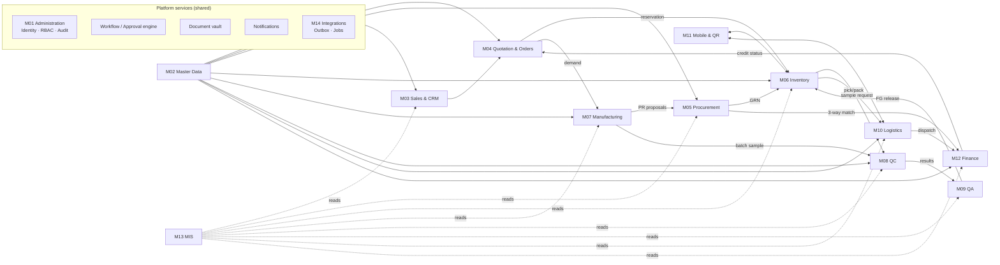

# 02 — Complete Module Inventory

Covers MP Part 30, Step 2. Module codes M01–M14 follow P3 §2. Screen codes such as `S-M04-03` are defined in doc 06.

## 0. Module map

## 1. Summary

| Module | Treatment (P3) | Submodules | Screens (doc 06) | Upstream dependencies | Release |
|---|---|---|---|---|---|
| M01 Administration & Security | Strengthen | 9 | 14 | — | Pilot |
| M02 Master Data | Expand | 20 masters | 22 | M01 | Pilot |
| M03 Sales & CRM | Retain 18 | 18 | 24 | M01, M02 | Core |
| M04 Quotation & Sales Orders | Correct | 6 | 10 | M02, M03, APR, M12 credit | Pilot |
| M05 Procurement | Expand | 8 | 12 | M02, APR, M06 | Pilot/Core |
| M06 Inventory & Warehouse | Expand | 13 | 16 | M02, M05, M08 | Pilot |
| M07 Manufacturing | Retain 16 | 16 | 18 | M02, M06, M08 | Pilot/Core |
| M08 Quality Control | Retain 6 | 6 (+dashboard, disposition) | 11 | M02, M06, M07 | Pilot |
| M09 Quality Assurance | Retain 17 | 17 | 22 | M07, M08, DMS | Pilot/Core |
| M10 Logistics & Dispatch | Expand | 7 | 10 | M04, M06, M09, M11 | Pilot |
| M11 Mobile & QR | Strengthen | 6 | 8 | M06, M07, M10 | Pilot/Core |
| M12 Finance | Conditional on D02 | 10 | 14 | M04, M05, M10 | Core |
| M13 MIS & Reporting | Correct | 4 | 9 | all | Core |
| M14 Integrations & Platform | Specify | 7 | 4 | — | Pilot |

---

## M01 — Administration & Security

**Responsibilities:** identity, authentication, roles and permissions, data scope, approval policies, delegation, audit, configuration, number series and the four executive administration positions.

| # | Submodule / feature | Key functions | Approval needed |
|---|---|---|---|
| 1 | User directory | Invite, activate, suspend, deactivate; link to employee | Independent approval for privileged roles |
| 2 | Authentication | Login, MFA, recovery, lockout, sessions, devices | — |
| 3 | Role & permission matrix | Module × action × scope; propose, approve, effective date | Security Admin + Executive Admin |
| 4 | Data-scope assignment | Legal entity, plant, warehouse, territory subtree | Security Admin |
| 5 | Approval policy designer | Rules, thresholds, approver groups, SLA; simulate, publish | Executive Admin |
| 6 | Delegation | Time-bound, limited to the delegator's authority | Delegator's manager (configurable) |
| 7 | Emergency access ("break-glass") | Time-boxed elevation with justification and post-review | Two executive admins |
| 8 | Audit viewer | Search, diff, export (audited) | — |
| 9 | Configuration & number series | Versioned settings, document templates, FY series | Executive Admin |

**Data:** `iam.users`, `roles`, `permissions`, `role_permissions`, `user_role_assignments` (with scope), `delegations`, `sessions`, `devices`, `sys.audit_events`, `sys.settings`, `sys.number_series`.
**Depends on:** none. Every other module depends on M01.

## M02 — Master Data Management

**Responsibilities:** authoritative records shared by every module (MP Rule 8). Lifecycle: Draft → Submitted → Verified → Approved → Active.

| # | Master | Owner | Notable rules |
|---|---|---|---|
| 1 | Company / Legal Entity | Finance | PAN and GSTIN per state registration |
| 2 | Branch / Plant | Plant | Linked to a legal entity |
| 3 | Warehouse / Zone / Bin | Stores | Type: RM, PM, FG, quarantine, rejected, transit, sample |
| 4 | Employee | HR | Manager, department, designation, tier |
| 5 | Department / Cost Centre | Finance | — |
| 6 | Territory | Sales | 7-level tree, effective-dated ownership |
| 7 | Dealer / Distributor | Sales / Fin | See M03/DLR; party model |
| 8 | Vendor / Supplier | Purchase | Qualification status, approved items |
| 9 | Transporter | Logistics | Permits, vehicles |
| 10 | Product (FG SKU) | Product owner | Pack variants, HSN, shelf life, category licence |
| 11 | Raw Material | Plant / Stores | Spec, storage class, hazard data |
| 12 | Packaging Material | Stores | — |
| 13 | Units of Measure | Stores | Item-specific conversions |
| 14 | Tax & HSN | Finance | Effective-dated rates |
| 15 | Product Category | Product owner | Drives licence eligibility (fertilizer, bio-stimulant, pesticide …) |
| 16 | BOM / Formulation | Plant / QA | Versioned, effective-dated (owned in M07) |
| 17 | Quality Specification | QC / QA | Parameters, methods, limits, versions (owned in M08) |
| 18 | Equipment / Instrument | Plant / QC | Calibration linkage |
| 19 | Bank & Financial Reference | Finance | IFSC, bank accounts |
| 20 | Document Types | Admin | Mandatory rules, expiry, retention |

**Design choice:** dealers, vendors and transporters share one `party` table with role records (`party_roles`), so one GSTIN cannot exist as two unrelated records and a vendor that is also a dealer gets one ledger identity.

## M03 — Sales & CRM (the 18 sub-modules in BRD p.10–11)

| # | BRD sub-module | Main screens (doc 06) | Approvals |
|---|---|---|---|
| 1 | CRM Dashboard & KPIs | S-M03-01 | — |
| 2 | Lead Capture & Management | S-M03-02, -03, -22 | — |
| 3 | BANT Qualification Engine | S-M03-03 | — |
| 4 | Opportunity Pipeline (Kanban) | S-M03-04, -05 | — |
| 5 | Commercial Activity Log | S-M03-06 | — |
| 6 | Customer 360° Comprehensive View | S-M03-17 | — |
| 7 | 9-Tier Hierarchy Rights Governance | S-M01-06 (authority limits), S-M02-05 (territory), S-M03-23 | Executive Admin publish |
| 8 | Competitor Market Intelligence | S-M03-14 | — |
| 9 | Price List & Tiered Discount Control | S-M03-09, -10 | BH + FH |
| 10 | Sample Requisition & Dispatch | S-M03-12 | SASM/ASM per BRD tier rights |
| 11 | Field Trial Assay Evaluation | S-M03-13 | RSM authorises trials |
| 12 | Zonal Target Setting & Allocation | S-M03-07, -08 | NSM/BH publish |
| 13 | Outstanding Debt & Recovery Hub (aging > 30/60/90) | S-M03-18 | — |
| 14 | Dealer Order Approval Register | S-M03-19 (orders processed in M04) | — |
| 15 | Executive Level Analytics (BH/NSM/DSM) | S-M03-20, -21 | — |
| 16 | Contract Pricing & Annual Volume Agreements | S-M03-11 | Contract approval |
| 17 | Commercial Beat Plan & Tour Program | S-M03-15, -16 | Manager approves the tour plan |
| 18 | Export Clean Excel / CSV Engine | S-M03-24 | Export permission |

**Data:** `sales.leads`, `lead_qualifications`, `opportunities`, `activities`, `targets`, `price_lists`, `price_list_items`, `schemes`, `samples`, `field_trials`, `competitor_entries`, `beat_plans`, `beat_visits`, `contracts`.
**Depends on:** M01 (territory scope), M02 (party, product), M12 (outstanding).

## M04 — Quotation & Sales Orders

| # | Submodule | Functions |
|---|---|---|
| 1 | Quotation editor | Multi-item lines, taxes, validity, versions, PDF/email |
| 2 | Quotation approval | Discount/value routing via APR |
| 3 | Sales order | From quote, PO, contract or channel; dealer PO attachment |
| 4 | Order validation | The 10 checks in MP§9.2 |
| 5 | Order approval & amendments | Revisions, approval invalidation |
| 6 | Allocation & backorder | Reserve released FG lots, backorder, MTO trigger |

**Data:** `sales.quotations`, `quotation_lines`, `quotation_versions`, `sales_orders`, `sales_order_lines`, `sales_order_revisions`; links to `inv.reservations`, `wf.approval_requests`.
**Depends on:** M02, M03 (pricing), APR, M06 (availability), M12 (credit exposure).

## M05 — Procurement

| # | Submodule | Functions | Approval |
|---|---|---|---|
| 1 | Purchase Requisition | Manual or from MRP; cost centre; priority | Dept head, then budget owner |
| 2 | RFQ | Multi-vendor and multi-item; deadline; responses | — |
| 3 | Comparative Statement | Landed cost, quality, lead time | Purchase Head (vendor selection) |
| 4 | Purchase Order | Multi-item; schedule lines; terms; versions | Value-based |
| 5 | Delivery Tracking | Expected vs received schedule | — |
| 6 | Invoice Matching | Three-way match, tolerances, exception queue | Finance for exceptions |
| 7 | Supplier Returns | Against GRN and lot; debit note | Purchase + QC |
| 8 | Vendor Performance | OTIF, rejection %, price variance | — |

**Data:** `proc.purchase_requisitions(+lines)`, `rfqs`, `rfq_vendors`, `vendor_quotes(+lines)`, `purchase_orders(+lines, +revisions)`, `supplier_invoices(+lines)`, `match_results`, `supplier_returns`.

## M06 — Inventory & Warehouse

| # | Submodule | Functions |
|---|---|---|
| 1 | Gate entry | Vehicle in/out, linked PO |
| 2 | GRN & quarantine | Lot creation, automatic quarantine, sample request to QC |
| 3 | Stock ledger | Immutable movements, running balances |
| 4 | Stock search & views | By item, lot, warehouse, bin, quality status |
| 5 | Reservations | Concurrency-safe allocation to SO, production or sample |
| 6 | Material issue | To production order; FEFO suggestion |
| 7 | Transfers | Warehouse to warehouse, via in-transit |
| 8 | Putaway & bin moves | — |
| 9 | Cycle count | Count plan, variance, approval |
| 10 | Adjustments | Independent approval (BR-08) |
| 11 | Damage / expiry / rejection | Automatic and manual segregation |
| 12 | Reorder & expiry alerts | — |
| 13 | Valuation | Weighted average or FIFO (D05) |

**Data:** `inv.lots`, `stock_movements`, `stock_balances` (derived and maintained in the same transaction), `reservations`, `transfers`, `count_sheets`, `adjustments`, `gate_entries`, `goods_receipts(+lines)`.

## M07 — Manufacturing (the 16 sub-modules in BRD p.18)

| # | BRD sub-module | Notes |
|---|---|---|
| 1 | Production Dashboard & OEE | Daily MT, OEE (formula D23), achievement, running reactors, losses |
| 2 | Production Planning (MRP) | SO + forecast → schedules and RM demand; PR proposals |
| 3 | Production Orders Register | Planned MT, line, launch date, deadline; release/amend/cancel |
| 4 | Plant Operations Calendar | Gantt: batch runs, CIP cleaning, maintenance downtime, shift changeovers |
| 5 | BOM & Formulation Master | Kg/MT ratios, temperature, reaction time, standard yield %; versions and effective dates |
| 6 | Material Consumption Dosing | Internal lot, supplier lot, GRN ref, dosing weight; tolerance check |
| 7 | Yield & Mass Balance Engine | Input = FG + process loss + recovered scrap |
| 8 | Loss, Waste & Scrap Tracking | Reactor residue, dust filter, evaporation, packaging spillage |
| 9 | Recycle & Rework Engine | Off-spec fines back into secondary mixing; genealogy kept |
| 10 | Packaging Line Operations | 50 kg bags, 1 kg pouches, 1 L bottles; bag counter; tare checks; box serial + QR (M11) |
| 11 | Finished Goods Stock Transfer | Plant floor → WH-01; stays QA-unreleased until the QA Head disposition |
| 12 | Batch Traceability Graph | Backward and forward |
| 13 | Quality Integration (IPQC) | Viscosity, reaction completion, bulk density gates |
| 14 | Production Costing Ledger | RM + energy + labour + packaging + overhead per MT |
| 15 | Production Reports & Audits | Shift reports, downtime, maintenance history, operator efficiency |
| 16 | Plant & Line Settings Master | Plants (Chakan 1, Baramati 2), lines, shifts A/B/Night, machine parameters |

**Data:** `mfg.bom_headers`, `bom_versions`, `bom_lines`, `bom_alternates`, `production_orders`, `batches`, `batch_steps`, `material_consumptions`, `process_readings`, `batch_outputs`, `production_losses`, `packaging_runs`, `downtime_events`.

## M08 — Quality Control (the 6 sub-modules in BRD p.15)

| # | BRD sub-module | Functions |
|---|---|---|
| 1 | QC Testing & CoA Register | Samples in 5 categories (RM, IPQC, FG, PM, reagent); results; CoA with signatures, seal and CoA QR |
| 2 | Strict Quarantine Lock | Automatic lock on GRN; release by the QC Manager with CoA; dual-authorisation override (D33) |
| 3 | Specification & Method Master | STPs per FCO 1985 / IS; parameters (assay %, pH, solubility, bulk density); methods (HPLC, AAS) |
| 4 | OOS & OOT Investigation Log | Investigation report, root cause, retest protocol, final disposition |
| 5 | Instruments & Calibration | HPLC, AAS, pH meters, moisture balances; due dates; an overdue instrument is locked |
| 6 | QC Hierarchy Governance | Analyst enters data only; Manager approves, signs CoA, releases quarantine |
| + | QC dashboard; chain-of-custody and retention samples (additions) | MP §13.1–13.2 |

**Data:** `qc.specifications(+versions, +parameters)`, `test_methods`, `samples`, `sample_custody_events`, `test_results`, `result_reviews`, `coas`, `oos_cases`, `instruments`, `calibrations`, `lot_dispositions`.

## M09 — Quality Assurance (17 BRD submodules kept)

| # | Submodule | Links |
|---|---|---|
| 1 | SOP Management | DMS, Training |
| 2 | Document Version Control | DMS |
| 3 | Change Control | BOM, spec, SOP versions |
| 4 | CAPA Management | Deviation, NC, audit, complaint |
| 5 | Deviation Management | Batch and lot; blocks release |
| 6 | Non-Conformance | Lot, supplier |
| 7 | Incident Management | — |
| 8 | BMR/BPR Review | M07 batch record |
| 9 | Internal Quality Audits | CAPA |
| 10 | Supplier Quality Audits | Vendor qualification |
| 11 | Customer / Regulatory Audits | CAPA |
| 12 | Training Compliance | SOP version, user |
| 13 | Specification Approval | M08 specs |
| 14 | Quality Risk Management | Risk register |
| 15 | Complaint Investigation | Dealer, shipment, batch |
| 16 | Recall Management | Genealogy, shipments |
| 17 | QA Rights Governance | M01 QA authorities |
| + | Finished-goods disposition | Release, Hold, Reject, Rework |

**Data:** `qa.controlled_documents(+versions)`, `change_requests`, `deviations`, `non_conformances`, `incidents`, `capas`, `capa_actions`, `batch_reviews`, `batch_dispositions`, `audits`, `audit_findings`, `training_requirements`, `training_records`, `risks`, `complaints`, `recalls`, `recall_lines`.

## M10 — Logistics & Dispatch

| # | Submodule | Functions |
|---|---|---|
| 1 | Dispatch planning | Queue grouped by destination, date, dealer, warehouse, priority |
| 2 | Picking | Pick list from reservations; FEFO; lot validation |
| 3 | Packing & box scan | Box to shipment line |
| 4 | Transporter allocation | Vehicle, driver, LR |
| 5 | Shipping documents | Invoice, DC, packing list, e-way bill reference, LR |
| 6 | POD | Received quantity, shortage, damage, upload |
| 7 | Exceptions & returns | Partial, RTO, return, freight dispute, freight reconciliation |

**Data:** `log.shipments`, `shipment_lines`, `shipment_boxes`, `pick_lists`, `vehicle_assignments`, `lorry_receipts`, `delivery_proofs`, `returns(+lines)`, `freight_charges`.

## M11 — Mobile & QR

| # | Submodule | Functions |
|---|---|---|
| 1 | Serial & QR generation | Box serial, HMAC token, label print jobs |
| 2 | Internal scanner | Pack, move, pick, load, dispatch, receive, return, verify |
| 3 | Offline queue & sync | Local event store, idempotent batch sync |
| 4 | Conflict resolution | Operator queue on the web |
| 5 | Serial trace | Box history |
| 6 | Public verification | Limited, rate-limited page |

**Data:** `log.serial_boxes`, `scan_events`, `scan_conflicts`, `iam.devices`.

## M12 — Finance (scope depends on D02)

| # | Submodule | Model A (native) | Model B (subledger + external GL) |
|---|---|---|---|
| 1 | Customer / vendor / transporter ledgers | Full | Subledger |
| 2 | Credit control | ✔ | ✔ |
| 3 | Invoice engine & e-invoice / e-way bill | ✔ | ✔ |
| 4 | Receipts & allocation | ✔ | ✔ |
| 5 | Vendor payable & payments | ✔ | Payable; payment in external GL |
| 6 | Credit / debit notes | ✔ | ✔ |
| 7 | Accounting posting | Native GL journal | Posting to external system with acknowledgment |
| 8 | Bank reconciliation | ✔ | External |
| 9 | Tax reporting | ✔ | Outward/inward registers |
| 10 | Period close | ✔ | Posting lock + reconciliation |

**Data:** `fin.invoices(+lines)`, `credit_profiles`, `receipts`, `allocations`, `credit_notes`, `debit_notes`, `ledger_entries`, `posting_batches`, `external_postings`, `periods`.

## M13 — MIS & Reporting

| # | Submodule | Functions |
|---|---|---|
| 1 | Departmental dashboards (10) | Executive, Sales, Purchase, Warehouse, Production, QC, QA, Logistics, Finance, Admin |
| 2 | Standard reports (about 50) | Listed in doc 06 §4 |
| 3 | KPI dictionary | Formula, owner, refresh rate |
| 4 | Report builder & schedules | Enterprise release |

Reads from read-optimised SQL views and materialised views. Row-level scope is enforced in the query layer.

## M14 — Integrations & Platform

| # | Component | Purpose |
|---|---|---|
| 1 | Transactional outbox | Reliable domain events |
| 2 | Job queue & workers | PDF, notifications, imports, schedules |
| 3 | Notification service | In-app, email, WhatsApp |
| 4 | GST e-invoice / e-way bill adapter | Through a GSP (D27) |
| 5 | Accounting adapter | Model B (D02) |
| 6 | Document / PDF service | Quotation, PO, CoA, invoice, DC, LR templates |
| 7 | Import / export service | Masters and opening balances |
