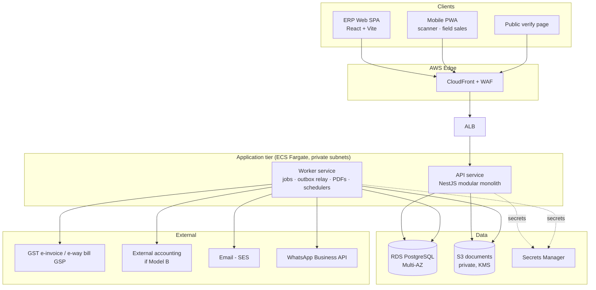

# 03 — Application Architecture

Covers MP Parts 3, 22, 24 and 25, and P4 §1 and §8. These are proposals; items marked with a decision ID are not yet final.

## 1. Architecture decisions (proposed)

| # | Decision | Choice | Why | Alternatives considered |
|---|---|---|---|---|
| AD-01 | Deployment shape | **Modular monolith**: one deployable API, plus a separate worker process from the same codebase | Strong consistency across stock, quality and finance; simpler operations for the team size in P5 §3 | Microservices (premature; too many distributed transactions) |
| AD-02 | Backend | **Node.js 22 LTS + TypeScript + NestJS** (NestJS runs on Express, which fits the BRD's "Node.js/Express containers"; deployed as a modular monolith, not microservices) | MP§3.2; module boundaries and dependency injection map naturally to the domains | Structured Express (more boilerplate for guards and pipes) |
| AD-03 | Data access | **Drizzle ORM** for typed queries, plus SQL migrations | Explicit SQL control for locking (`SELECT … FOR UPDATE`) and the ledger tables | Prisma (weaker row-locking and raw SQL ergonomics), TypeORM |
| AD-04 | Database | **PostgreSQL 16**, one database with one schema per domain | MP§3.3 | — |
| AD-05 | Frontend | **React 18 + TypeScript + Vite SPA** (confirmed: BRD p.20 names a React/Vite SPA on CloudFront; D19 closed) | The ERP sits behind a login and needs no SSR/SEO. Vite is what MP§3.1 specifies. The public QR verification page is a separate small SSR/static route. | Next.js (the UI prompt's suggestion) — **D19** |
| AD-06 | UI stack | Tailwind CSS with design tokens, Radix UI primitives (accessible), Lucide icons, Recharts, Framer Motion, TanStack Query/Table, React Hook Form + Zod | UI§39–40; MP§3.1 | MUI (fights the visual language) |
| AD-07 | Shared contracts | Zod schemas in a shared package, used for frontend validation and backend DTOs, with OpenAPI generated from them | One source of truth for validation | Hand-written OpenAPI |
| AD-08 | Workflow engine | **In-house state-machine and approval-policy service** inside the monolith | Approvals must sit in the same DB transaction as state changes (MP R4) | Camunda/Temporal (heavy; separate source of truth) |
| AD-09 | Queue | **Postgres transactional outbox → BullMQ on ElastiCache Redis** (BRD p.20 names Redis for sessions, OTP state and PDF queues). Redis runs with AOF persistence, and the outbox guarantees no event is lost if Redis restarts | Follows the BRD while keeping business commits atomic (D35) | pg-boss only (the v0.1 proposal) |
| AD-10 | Identity | Built-in identity module (argon2id, TOTP MFA, WebAuthn optional). OIDC federation hook for later SSO | No IdP named in the sources — **D22** | AWS Cognito, Keycloak, Entra ID |
| AD-11 | File storage | Amazon S3 (private, SSE-KMS); access by short-lived pre-signed URLs | MP§3.4 | — |
| AD-12 | PDF generation | HTML templates rendered by headless Chromium in the worker | Pixel-accurate GST invoice and CoA layouts | PDFKit (hard to maintain) |
| AD-13 | Mobile | **PWA first** (camera scanning, IndexedDB offline queue). Capacitor Android wrapper if rugged-scanner SDKs or kiosk mode are needed | One codebase; P4 §1 says "PWA or packaged Android after device testing" — **D09** | Native Kotlin |
| AD-14 | Cloud | AWS, Mumbai region (ap-south-1) proposed | Data residency and latency — **D21** | — |

## 2. Logical architecture



## 3. Backend module structure

Each domain module owns its schema. A module may **read** another module's data only through that module's exported service interface or published read views, and may **write** only through its commands. Rules are enforced by ESLint boundary rules and dependency-cruiser in CI.

```
apps/
  api/                      # NestJS HTTP app (composition root)
  worker/                   # NestJS standalone app: jobs, outbox relay, schedulers
  web/                      # React SPA
  mobile/                   # PWA (shares UI kit with web)
  verify/                   # public verification page (static/SSR, minimal)
packages/
  contracts/                # Zod schemas, DTOs, enums, error codes, OpenAPI gen
  ui/                       # design system components + tokens (doc 10)
  domain-kernel/            # Money, Quantity, UOM, DocumentNumber, Result types
  config/                   # eslint, tsconfig, tailwind preset
modules/ (inside apps/api/src)
  platform/  iam/ audit/ workflow/ documents/ notifications/ numbering/ settings/ outbox/
  org/       legal-entities, plants, warehouses, territories, departments
  masters/   parties, items, uom, tax, categories, banks, document-types
  sales/     crm, pricing, quotations, sales-orders, targets, samples, beats
  procurement/ requisitions, rfq, purchase-orders, invoice-match, supplier-returns
  inventory/ gate, grn, lots, ledger, reservations, issues, transfers, counts, adjustments
  manufacturing/ bom, mrp, production-orders, batches, packaging, oee, costing
  qc/        specs, samples, results, coa, oos, instruments
  qa/        documents, change, deviation, capa, batch-review, disposition, audits, training, complaints, recall
  logistics/ dispatch, picking, shipments, pod, returns, freight
  serialisation/ boxes, qr, scans, offline-sync, public-verify
  finance/   credit, invoices, receipts, payables, notes, postings, periods
  reporting/ dashboards, reports, kpi-dictionary, exports
  integrations/ gsp, accounting, email, whatsapp
```

### 3.1 Request pipeline (every endpoint)

1. **AuthN guard**: validates the session or access token; MFA claims for privileged routes.
2. **Permission guard**: `@Require('sales_order','approve')`, resolved against the user's roles.
3. **Scope resolver**: builds the user's data scope (entity, plant, warehouse IDs and territory subtree path) and passes it to repositories, which always filter by it. There are no unscoped repository methods outside the platform module.
4. **Validation pipe**: Zod schema from `packages/contracts`.
5. **Idempotency interceptor**: for `POST` commands that carry an `Idempotency-Key` header, stores the request hash and response; a replay returns the stored response.
6. **Command handler**: one DB transaction for the state change, the audit event and the outbox event(s).
7. **Error mapper**: produces the standard error envelope (doc 08 §2).

### 3.2 Workflow & approval engine

- **State machines** are declared per document type (doc 05 §12) as data: states, transitions, guard names and required permission. A transition is the *only* way to change `status`. A database trigger rejects direct status updates that do not come through a session variable set by the engine.
- **Approval policy** = an ordered list of rules: `match(document facts) → steps[]`. Facts include amount, max discount %, credit-exposure ratio, territory, product categories and exception flags. Steps resolve to an approver *role at hierarchy level*, a named group or "reporting manager of initiator, N levels up".
- A policy version is immutable once published. Every approval request stores `policy_version_id`.
- **Materiality**: each document type declares which fields are material. Amending a material field cancels open steps and re-runs the policy. Non-material edits (such as a remark) do not.
- **Segregation**: the engine rejects a decision when the approver is the initiator, or when the approver already acted on an earlier step and the policy marks those steps as needing distinct approvers.
- SLA timers are scheduled jobs that escalate or notify, and they are idempotent.

### 3.3 Consistency patterns

| Concern | Pattern |
|---|---|
| Stock reservation race | `SELECT … FOR UPDATE` on the `stock_balances` row(s) for (item, lot, location, quality status), then a check that `available − reserved ≥ qty` inside the same transaction. A `CHECK (reserved ≤ on_hand)` constraint is the last line of defence. |
| Lost updates on documents | `version` integer column; updates use `WHERE id=? AND version=?`; a conflict returns 409 `CONCURRENT_MODIFICATION`. |
| Duplicate posting | Unique `(source_type, source_id, posting_kind)` on postings; idempotency keys on external calls; the outbox relay is at-least-once and consumers are idempotent. |
| Offline scans | Client-generated UUIDv7 `event_id` with a unique constraint. The server validates against current state and returns accepted, rejected or conflict per event. |
| Immutable history | Ledger tables (`stock_movements`, `ledger_entries`, `audit_events`, `test_results`) have no UPDATE or DELETE grants for the app role. Corrections are made by reversal rows. |

## 4. Frontend architecture

- **Routing:** React Router with lazy-loaded module bundles. The route manifest is filtered by the permissions returned from `/api/v1/me`.
- **Server state:** TanStack Query; query keys include the scope hash. Mutations invalidate by document.
- **Forms:** React Hook Form + Zod (shared schemas). The server is still authoritative and its errors map onto fields.
- **Line-item editor:** one reusable `<LineItemGrid>` used by quotations, sales orders, PR, PO, GRN, transfers and invoices. It supports keyboard entry and add/remove/duplicate rows, and recalculates through the server endpoint `/…/calculate`, so tax logic exists only once.
- **Action bar:** buttons are rendered from the `allowedActions[]` the server returns with each document (state × permission × segregation). The client never decides on its own.
- **App shell:** sidebar, header and optional right context panel, as in doc 10.

## 5. Security architecture

| Control | Implementation |
|---|---|
| Sessions | HTTP-only, Secure, SameSite=Lax cookie with a rotating refresh token. Idle timeout 30 min and absolute timeout 12 h (configurable). CSRF double-submit token. |
| MFA | TOTP, with WebAuthn optional; required for the role flags `privileged`, `finance_poster`, `qa_releaser`, `admin` |
| Passwords | argon2id; breached-password check (k-anonymity) as an option |
| Authorisation | RBAC (permissions) + ABAC (scope, state, ownership, segregation) |
| Secrets | AWS Secrets Manager; none in code or environment files |
| Encryption | TLS 1.2+; RDS and S3 KMS encryption; PII columns (PAN, bank account, Aadhaar if ever stored) encrypted at application level with envelope keys and masked in the UI by default |
| Documents | Pre-signed GET URLs valid for 5 minutes, issued only after an authorisation check and audit log; antivirus scan on upload (ClamAV worker) |
| Audit | Append-only `audit_events`, partitioned monthly, with a hash chain (`prev_hash`) for tamper evidence |
| Edge | WAF managed rules, rate limits, geo/IP allow-list for admin routes (optional) |
| Verification | OWASP ASVS L2 checklist, SAST/dependency scanning in CI, external penetration test before go-live |

## 6. Environments & deployment

| Environment | Purpose | Data | Deployment |
|---|---|---|---|
| Development | Developer integration | Synthetic, clearly marked `[SAMPLE]` | Auto-deploy on merge to `develop` |
| Staging / UAT | UAT, migration rehearsals, performance tests | Anonymised copy or rehearsal migration | Promote a tagged build; manual approval |
| Production | Live | Real | Promote the same image digest from staging after sign-off. Blue/green on ECS; DB migrations are backward-compatible (expand → migrate → contract) |

CI pipeline: lint → typecheck → unit → API/integration (Testcontainers Postgres) → build → SAST/dependency audit → container scan → deploy dev → e2e smoke.

## 7. Non-functional targets (proposed, D21)

| Attribute | Proposed target |
|---|---|
| Availability | BRD p.20 asks **99.95%**. Proposed: 99.5% business hours for the Pilot, rising to 99.9% (24×7) at Core. 99.95% is possible with Multi-AZ RDS and multi-task ECS at higher cost (D21) |
| RPO / RTO | RPO ≤ 15 min (PITR); RTO ≤ 4 h; restore tested every quarter |
| Backups | Daily snapshot kept 35 days; monthly kept 12 months; S3 versioning plus Object Lock for controlled QA documents |
| Performance | p95 ≤ 500 ms for reads and ≤ 1 s for commands at 200 concurrent users; list pages paginate on the server at 25/50/100 rows |
| Scale assumptions | To validate: ~300 internal users, ~50k sales order lines/year, ~5k batches/year, ~2M scan events/year. BRD p.20 mentions "thousands of concurrent dealer orders"; realistic peak numbers are needed (D21) |
| Observability | OpenTelemetry traces, CloudWatch metrics and logs, alerts on error rate, queue age, DLQ depth and posting failures |
| Browser support | Latest 2 versions of Chrome, Edge, Safari and Firefox; tablet 768px+ |
