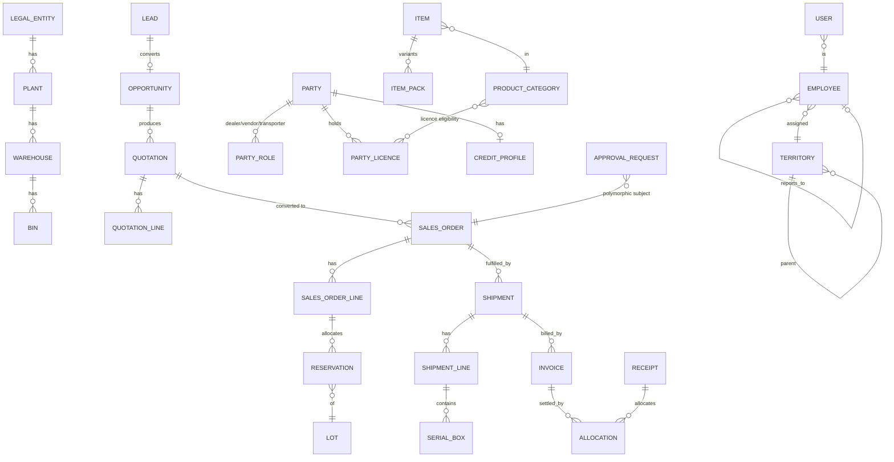
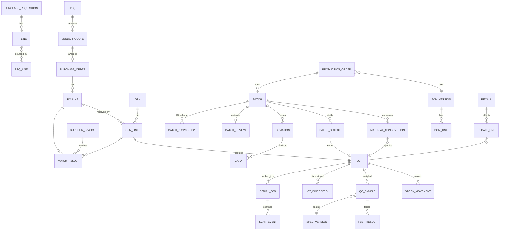

# 04 — Database Design

Covers MP Part 23, Part 30 Step 3, and P4 §3. This is a proposal: the physical names and column lists are what development would start from, and are not yet frozen.

## 1. Conventions

| Topic | Convention |
|---|---|
| Schemas | `iam`, `org`, `mdm`, `wf`, `sales`, `proc`, `inv`, `mfg`, `qc`, `qa`, `log`, `fin`, `sys`, `rpt` |
| Primary keys | `id uuid` (UUIDv7, sortable by time) on every table |
| Business numbers | `doc_no text` from `sys.number_series`. Format example: `SO/DAT/2026-27/000123`, configurable (D28). Unique per `(legal_entity_id, doc_type, doc_no)` |
| Standard columns | `legal_entity_id`, `created_at`, `created_by`, `updated_at`, `updated_by`, `version int` (optimistic lock), `status` (FK to that document's state machine) |
| Money / quantity | `numeric(18,2)` INR; `numeric(18,4)` quantity; `numeric(9,4)` rates and percentages; each quantity stored with its `uom_id` |
| Time | `timestamptz` in UTC; business dates as `date` (IST) |
| Soft delete | Not used on transactions. Masters use `status = Inactive`. Drafts can be hard-deleted only while still `Draft` and never submitted |
| Effective dating | `valid_from date`, `valid_to date null`, with a GiST exclusion constraint so validity ranges do not overlap per key |
| Hierarchies | Territory and org trees use `ltree path`, so subtree scope queries are a single indexed `path <@ $scope` filter |
| Foreign keys | Always declared. `ON DELETE RESTRICT` by default |

## 2. Conceptual ERD — core flow

## 3. Conceptual ERD — supply, production, quality

## 4. Logical schema — principal tables

Only the key columns are listed. The full data dictionary is produced in the first development stage, from approved screen fields (doc 06).

### 4.1 iam / org / sys

| Table | Key columns | Constraints / indexes |
|---|---|---|
| `org.legal_entities` | code, name, pan, cin, registered_address | uq(code) |
| `org.gst_registrations` | legal_entity_id, state_code, gstin, valid_from/to | uq(gstin); check gstin ~ `^[0-9]{2}[A-Z]{5}[0-9]{4}[A-Z][1-9A-Z]Z[0-9A-Z]$` |
| `org.plants`, `org.warehouses`, `org.bins` | code, parent FK, type, status | uq(parent, code) |
| `org.territories` | code, name, level (enum 1–7), path ltree, parent_id | gist(path); uq(code) |
| `org.territory_assignments` | territory_id, employee_id, role_tier, valid_from/to | exclusion: no overlap per (territory, role_tier) |
| `iam.users` | email, username, password_hash, mfa_secret_enc, status, employee_id | uq(lower(email)) |
| `iam.employees` | emp_code, name, department_id, designation, tier (BH…SE, null for non-sales), manager_id | uq(emp_code) |
| `iam.roles`, `iam.permissions`, `iam.role_permissions` | permission = (resource, action) | uq(resource, action) |
| `iam.user_role_assignments` | user_id, role_id, scope_type, scope_ids uuid[], territory_path ltree, valid_from/to, approved_by | gin(scope_ids) |
| `iam.authority_limits` | role_tier, doc_type, max_discount_pct, max_value, policy_version_id, active | Seeded from MP§4.4 as **inactive** |
| `iam.delegations` | from_user, to_user, scope, valid_from/to, reason | check from ≠ to |
| `iam.devices` | user_id, device_fingerprint, platform, registered_at, revoked_at | — |
| `sys.audit_events` | occurred_at, actor_id, actor_role, action, entity_type, entity_id, before jsonb, after jsonb, ip, device_id, reason, prev_hash, hash | Partitioned by month; brin(occurred_at); idx(entity_type, entity_id) |
| `sys.number_series` | legal_entity_id, doc_type, fy, prefix, next_value | Row lock on allocation; gaps are allowed and audited |
| `sys.outbox_events` | aggregate_type, aggregate_id, event_type, payload, created_at, published_at, attempts | idx(published_at) WHERE null |
| `sys.idempotency_keys` | key, user_id, route, request_hash, response, created_at | uq(user_id, key); TTL 7 days |
| `sys.files` | storage_key, mime, size, sha256, uploaded_by, av_status | — |
| `sys.documents` | doc_type_id, entity_type, entity_id, file_id, version, valid_until, status | idx(entity_type, entity_id) |
| `sys.notifications`, `sys.notification_deliveries` | dedupe_key, channel, status, attempts | uq(dedupe_key, channel, recipient) |

### 4.2 wf (approval engine)

| Table | Key columns |
|---|---|
| `wf.state_machines` | doc_type, version, definition jsonb |
| `wf.policies` / `wf.policy_versions` | doc_type, version, rules jsonb, published_at, published_by, simulated_at |
| `wf.approval_requests` | subject_type, subject_id, subject_revision, policy_version_id, facts jsonb (snapshot), status, initiated_by, submitted_at, sla_due_at |
| `wf.approval_steps` | request_id, seq, approver_rule, resolved_approver_ids uuid[], status, due_at |
| `wf.approval_decisions` | step_id, actor_id, actor_role, on_behalf_of (delegation), decision, remarks, decided_at |

`uq(subject_type, subject_id, subject_revision) WHERE status IN ('Pending','OnHold')`: only one live approval request per document revision.

### 4.3 mdm

| Table | Key columns | Notes |
|---|---|---|
| `mdm.parties` | code, legal_name, trade_name, constitution, pan_enc, primary_gstin, status | uq(primary_gstin) where not null; trigram index on legal_name for duplicate detection |
| `mdm.party_roles` | party_id, role (DEALER/VENDOR/TRANSPORTER/CUSTOMER), status, onboarding_request_id | uq(party_id, role) |
| `mdm.party_addresses`, `mdm.party_contacts`, `mdm.party_bank_accounts` | … verified_at, verified_by | — |
| `mdm.party_licences` | party_id, licence_type, number, issuer, valid_from/to, product_category_ids uuid[], document_id, verification_status | idx(valid_to) for expiry jobs |
| `mdm.dealer_profiles` | party_id, territory_id, sales_owner_id, price_group_id, dealer_category, annual_target | — |
| `mdm.items` | code, name, item_type (FG/RM/PM/SAMPLE/SERVICE), category_id, base_uom_id, hsn_id, shelf_life_days, storage_class, lot_controlled, serial_controlled, status | uq(code) |
| `mdm.item_packs` | item_id, pack_code, pack_size, pack_uom_id, units_per_box, gtin | uq(item_id, pack_code) |
| `mdm.uom`, `mdm.uom_conversions` | item_id null (global) or specific, from, to, factor | — |
| `mdm.hsn_codes`, `mdm.tax_rates` | hsn_id, rate, cess, valid_from/to | exclusion: no overlap |
| `mdm.product_categories` | code, name, licence_type_required | e.g. FERTILIZER, BIO_STIMULANT, PESTICIDE (D08) |

### 4.4 sales

| Table | Key columns |
|---|---|
| `sales.leads` | doc_no, source, company, contact, mobile, territory_id, owner_id, status, follow_up_at, bant jsonb |
| `sales.opportunities` | lead_id, party_id, stage, value, probability, expected_close, lost_reason_id |
| `sales.activities` | type, subject_type/id, owner_id, planned_at, done_at, geo point, outcome |
| `sales.targets` | fy, period, territory_id, employee_id, item_category_id, qty, value, parent_target_id |
| `sales.price_lists`, `sales.price_list_items` | price_group_id, item_pack_id, rate, valid_from/to |
| `sales.schemes` | type (volume/trade/promo), rules jsonb, valid_from/to |
| `sales.quotations` | doc_no, revision, party_id, contact_id, bill_to, ship_to, place_of_supply_state, valid_until, price_list_id, payment_terms, delivery_terms, sales_owner_id, totals, status |
| `sales.quotation_lines` | quotation_id, line_no, item_pack_id, hsn, qty, uom_id, list_rate, discount_pct, rate, taxable, cgst, sgst, igst, total |
| `sales.sales_orders` | doc_no, revision, source_type, source_id, party_id, dealer_po_no, dealer_po_file_id, delivery_date, ship_to, totals, credit_snapshot jsonb, status |
| `sales.sales_order_lines` | order_id, line_no, item_pack_id, qty_ordered, qty_reserved, qty_dispatched, qty_cancelled, rate, discount_pct, tax… |
| `sales.document_revisions` | doc_type, doc_id, revision, snapshot jsonb, changed_fields text[], material bool, reason |
| `sales.samples`, `sales.field_trials`, `sales.beat_plans`, `sales.beat_visits`, `sales.contracts`, `sales.competitor_entries` | as specified in MP§7.8–7.12 |

Constraints: `uq(party_id, dealer_po_no)` on sales orders; check `qty_reserved + qty_dispatched + qty_cancelled ≤ qty_ordered`.

### 4.5 proc

`purchase_requisitions(+lines)`, `rfqs`, `rfq_lines`, `rfq_vendors`, `vendor_quotes(+lines)`, `comparative_statements`, `purchase_orders(+lines: qty_ordered, qty_received, qty_accepted, qty_returned, rate, tax, delivery_schedule)`, `supplier_invoices(+lines)`, `match_results(po_line_id, grn_line_id, inv_line_id, qty_var, price_var, tax_var, within_tolerance, resolution)`, `supplier_returns(+lines)`, `tolerance_policies`.

### 4.6 inv — stock model

Stock is described by **three independent dimensions** (answers P1 §5 "states are not mutually exclusive"):

1. **Where:** `location_id` (warehouse, bin) or the virtual `IN_TRANSIT` and `ISSUED_TO_WIP` locations.
2. **Quality status of the lot:** `QUARANTINE`, `RELEASED`, `QA_HOLD`, `REJECTED`, `EXPIRED`. This belongs to the *lot*, or to a lot portion when split.
3. **Condition:** `GOOD` or `DAMAGED`.

**Allocation** (reserved quantity) is a separate overlay, `inv.reservations`. It is not a stock state. So *available to promise* = on-hand where quality = RELEASED, condition = GOOD and not expired, minus active reservations. A quantity is never counted in two buckets.

| Table | Key columns | Notes |
|---|---|---|
| `inv.lots` | lot_no, item_id, source_type (GRN/BATCH/RETURN), source_id, supplier_batch, mfg_date, expiry_date, quality_status, parent_lot_id | uq(item_id, lot_no) |
| `inv.stock_movements` | movement_type, item_id, lot_id, from_location_id, to_location_id, condition, qty, uom_id, base_qty, unit_cost, source_doc_type, source_doc_id, source_line_id, actor_id, posted_at, reversal_of_id | **Append-only.** Index (item_id, lot_id, posted_at) |
| `inv.stock_balances` | item_id, lot_id, location_id, condition, on_hand, reserved | PK(item, lot, location, condition); `CHECK (on_hand ≥ 0)` unless the location allows negative; `CHECK (reserved ≤ on_hand)`; updated in the **same transaction** as each movement |
| `inv.reservations` | demand_type (SO_LINE/PROD_ORDER/SAMPLE), demand_id, item_id, lot_id, location_id, qty, status (ACTIVE/CONSUMED/RELEASED), expires_at | — |
| `inv.gate_entries`, `inv.goods_receipts`, `inv.grn_lines` | vehicle, po_id, received_qty, accepted_qty, condition | — |
| `inv.transfers(+lines)`, `inv.count_sheets(+lines)`, `inv.adjustments(+lines)`, `inv.material_issues(+lines)` | — | Adjustments need approval (BR-08) before their movement posts |

Movement types: `GRN_IN`, `PUTAWAY`, `BIN_MOVE`, `ISSUE_TO_PROD`, `RETURN_FROM_PROD`, `PROD_OUTPUT`, `TRANSFER_OUT`, `TRANSFER_IN`, `PICK`, `DISPATCH`, `CUSTOMER_RETURN_IN`, `SUPPLIER_RETURN_OUT`, `ADJ_GAIN`, `ADJ_LOSS`, `SCRAP`, `SAMPLE_OUT`, `CONDITION_CHANGE`, `REVERSAL`.

Quality status changes are recorded in `inv.lot_status_history` (lot, from, to, reason, disposition_id, actor) and are never written directly to the lot. They are applied through the dispositions in QC/QA.

### 4.7 mfg

`bom_headers(item_id)`, `bom_versions(version, valid_from/to, target_yield_pct, batch_size, status, approved_by)`, `bom_lines(input_item_id, qty_per_batch, uom_id, tolerance_pct, is_critical)`, `bom_alternates`, `process_steps(bom_version_id, seq, parameter specs)`, `production_orders(item_id, bom_version_id, planned_qty, plant_id, line_id, shift, planned_start/end, status)`, `batches(batch_no, production_order_id, started_at, completed_at, status)`, `batch_steps`, `material_consumptions(batch_id, bom_line_id, lot_id, qty, variance_pct, deviation_id)`, `process_readings`, `batch_outputs(lot_id, qty)`, `production_losses(type: PROCESS_LOSS/SCRAP/WASTE/RECOVERED/REWORK)`, `packaging_runs(+lines)`, `downtime_events`, `mrp_runs`, `mrp_suggestions`.

Mass-balance check: `Σ consumption.base_qty = Σ outputs + Σ losses (±tolerance)`. It is evaluated when the batch completes, and the batch cannot move to `QC_PENDING` until it passes or a deviation is linked.

### 4.8 qc / qa

QC: `specifications`, `spec_versions(valid_from/to, status)`, `spec_parameters(name, method_id, min, max, target, unit, is_critical)`, `test_methods`, `samples(sample_no, source_type, lot_id/batch_id, collected_by, qty, purpose: ROUTINE/RETEST/RETENTION/STABILITY)`, `sample_custody_events`, `test_results(sample_id, parameter_id, instrument_id, value, unit, analyst_id, entered_at, raw_file_id, status, superseded_by)`, `result_reviews(reviewer_id, decision)`, `coas(version, file_id, approved_by)`, `oos_cases`, `instruments`, `calibrations(due_at, certificate_file_id, status)`, `lot_dispositions(lot_id, decision, authority_role, actor_id, reason)`.

Constraint: `result_reviews.reviewer_id ≠ test_results.analyst_id`, enforced by a trigger. Results are never updated in place: a retest inserts a new row and links `superseded_by`.

QA: `controlled_documents`, `document_versions(effective_from, review_due, status)`, `change_requests`, `deviations(subject_type/id, severity, status)`, `non_conformances`, `incidents`, `capas`, `capa_actions`, `batch_reviews(batch_id, bmr_ok, bpr_ok, qc_ok, open_deviation_count)`, `batch_dispositions(batch_id, decision, actor_id, authority_ref)`, `audits`, `audit_findings`, `training_requirements(doc_version_id, role_id)`, `training_records`, `risks`, `complaints`, `recalls`, `recall_lines(lot_id, shipment_id, party_id, qty_shipped, qty_recovered)`.

Release guard (implemented in the service and repeated as a DB trigger): `batch_dispositions.decision = 'RELEASED'` requires every QC sample for the batch to be approved, the batch review to be complete, zero open deviations linked to the batch or its input lots, and an actor holding the `qa_releaser` authority for that plant.

### 4.9 log / serialisation

`shipments(doc_no, warehouse_id, transporter_id, vehicle_no, driver, status, eway_bill_no, lr_no)`, `shipment_lines(so_line_id, item_pack_id, lot_id, qty_planned, qty_packed, qty_dispatched, qty_delivered)`, `serial_boxes(serial, item_pack_id, lot_id, token_hash, status, current_location_id, shipment_line_id)`, `scan_events(event_id uuid UNIQUE, device_id, user_id, scan_type, serial, context jsonb, client_time, received_at, result: ACCEPTED/REJECTED/CONFLICT, reason)`, `scan_conflicts`, `delivery_proofs`, `returns(+lines)`, `freight_charges`, `lorry_receipts`.

Constraint: `uq(serial)` on boxes. A box can belong to only one *active* shipment line: a partial unique index on `serial_boxes(serial) WHERE status IN ('PACKED','LOADED','DISPATCHED')`, together with state-machine guards.

### 4.10 fin

`credit_profiles(party_id, limit, days, hold_flag, valid_from/to)`, `invoices(doc_no, irn, ack_no, signed_qr, shipment_id, party_id, place_of_supply, totals, status, posting_status)`, `invoice_lines`, `receipts(mode, ref, amount, party_id)`, `allocations(receipt_id, invoice_id, amount)`, `credit_notes`, `debit_notes`, `payables`, `vendor_payments`, `ledger_entries(party_id, entry_type, debit, credit, source_type, source_id)` (append-only), `postings(source_type, source_id, posting_kind, external_ref, status, attempts, last_error)` with **uq(source_type, source_id, posting_kind)**, `periods(fy, month, status: OPEN/SOFT_CLOSED/CLOSED)`.

**Credit exposure** (proposed formula, D18) = unpaid invoices + dispatched-but-not-invoiced + approved-not-dispatched orders − unapplied receipts. Each sales order stores a `credit_snapshot` of the exposure at the moment of approval.

## 5. Transaction boundaries

| Business command | Single DB transaction contains | Async (outbox) afterwards |
|---|---|---|
| Submit sales order | Validations, status → Submitted, approval request + steps, audit | Notify approvers |
| Approve final step | Decision, status → Approved, reservation attempt (row locks), audit | Notify initiator, warehouse |
| Post GRN | GRN, lots (QUARANTINE), movements, balances, PO line received qty, QC sample request, audit | Notify QC |
| Lot disposition | Disposition, lot status history, lot status, audit | Notify Stores/Plant |
| Issue to production | Lock balances, movements, reservations consumed, consumption rows | — |
| Complete batch | Outputs (new FG lot = QUARANTINE), losses, mass-balance check, status | Notify QC |
| QA release | Guard check, disposition, FG lot → RELEASED, audit | Notify Sales/Logistics, re-run backorder allocation job |
| Confirm dispatch | Shipment status, DISPATCH movements, SO line dispatched qty, release of reservations, box status | Generate invoice job, e-way bill job |
| Create invoice | Invoice, ledger entries, `postings` row (PENDING) | IRN job, accounting posting job (idempotent) |
| Sync scans | Each event in its **own savepoint**; accepted events post their movements | Conflict notifications |

## 6. Audit model

- `sys.audit_events` holds one row per command. It records field-level `before`/`after` for changed columns only, the reason (mandatory for overrides, amendments and adjustments), and links to the approval decision if there is one.
- Rows are hash-chained per partition (`hash = sha256(prev_hash || row)`). A nightly job checks the chain and alerts on a break.
- The app DB role has only `INSERT` on the audit tables. A separate read-only role serves the audit viewer.
- Retention: 8 years for finance, quality and stock (to be confirmed with the client's adviser, D25).

## 7. Data migration approach (D10)

| Step | Activity | Output |
|---|---|---|
| 1 | Inventory legacy sources (Tally/Excel/other, unknown) | Source register |
| 2 | Assign a data owner per entity; set cleansing rules (duplicate GSTIN, invalid HSN, inactive parties) | Cleansing log |
| 3 | Map to target templates (CSV/XLSX per master) with code cross-reference tables `sys.legacy_refs` | Mapping spec |
| 4 | Load masters → open documents (open POs, open SOs) → opening stock by lot and location (from a physical count) → opening AR/AP by invoice | Load scripts (idempotent) |
| 5 | Validation import runs fully in a staging schema: references are checked and the batch is rejected on any error (TC-19) | Error report |
| 6 | Reconcile: stock quantity and value against the count sheet; AR/AP against the trial balance; sign-off by owners | Reconciliation certificate |
| 7 | Two rehearsals in UAT, then cutover with a freeze window | Cutover runbook |

Opening stock enters through a dedicated `OPENING_BALANCE` movement type, so the ledger stays complete.
