# 05 — Workflow Diagrams

Covers MP Part 30, Step 4, and P2. Each diagram shows who is responsible (swimlanes as participants), approval points (◆), failure paths and the transactions that result. Routing that depends on an open decision is labelled with its ID.

---

## 1. Dealer onboarding (DLR-005; D07)

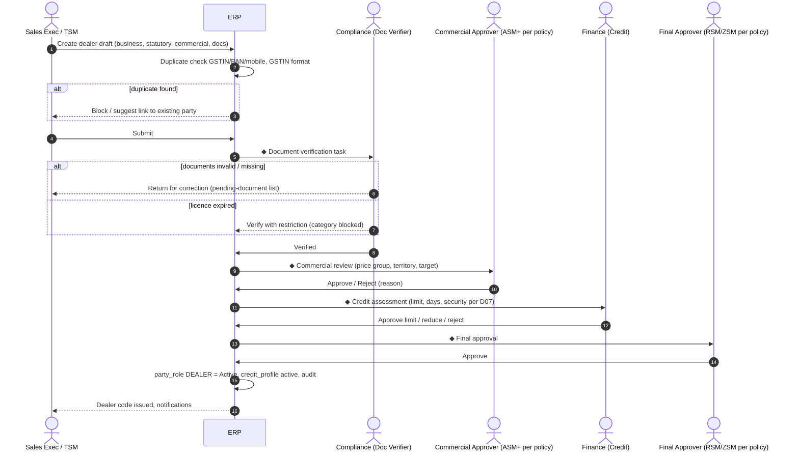

**Results:** `mdm.parties`, `party_roles(DEALER, Active)`, `party_licences(Verified)`, `credit_profiles`. Suspension is a separate one-step approval and blocks new quotations and orders at once.

---

## 2. Lead-to-cash

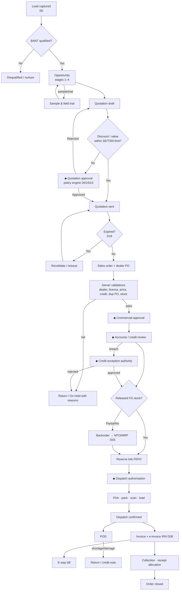

**Transactions:** lead → opportunity → quotation (versions) → sales order (revisions) → approval request → reservations → shipment → stock movements (`PICK`, `DISPATCH`) → invoice → ledger entries → postings → receipt → allocation.

---

## 3. Procure-to-pay

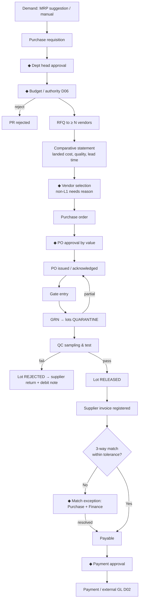

---

## 4. Inventory receipt & quarantine (INV-001, P7 §7)

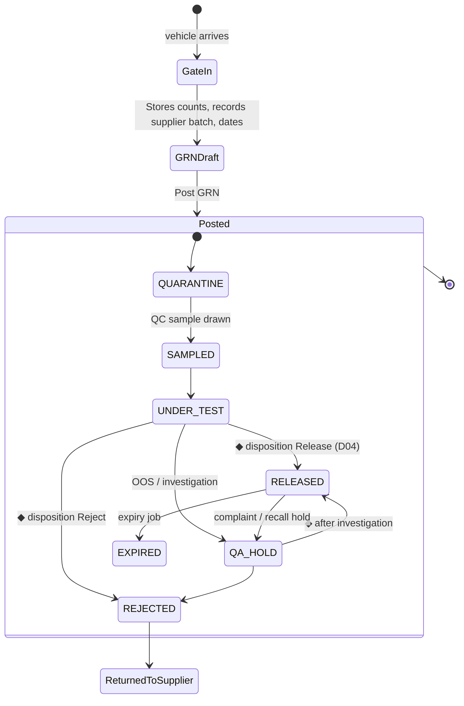

Guards: `ISSUE_TO_PROD`, `PICK` and `TRANSFER` are allowed only for `RELEASED` and `GOOD` stock. Any other attempt returns `422 LOT_NOT_ELIGIBLE` and writes an audit event (TC-08).

---

## 5. Production planning (MRP)

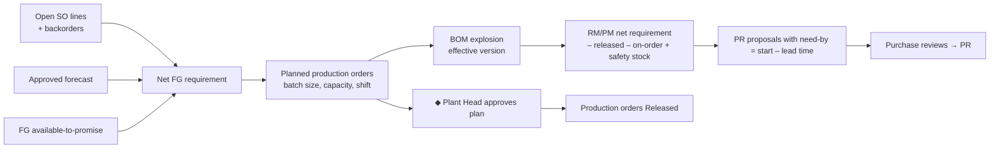

Make-to-stock, make-to-order or hybrid (D03) decides whether SO lines feed `NET` directly or only through the forecast.

---

## 6. Batch manufacturing

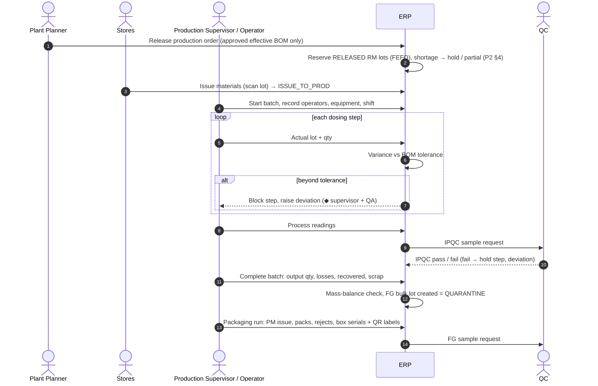

---

## 7. QC & QA release

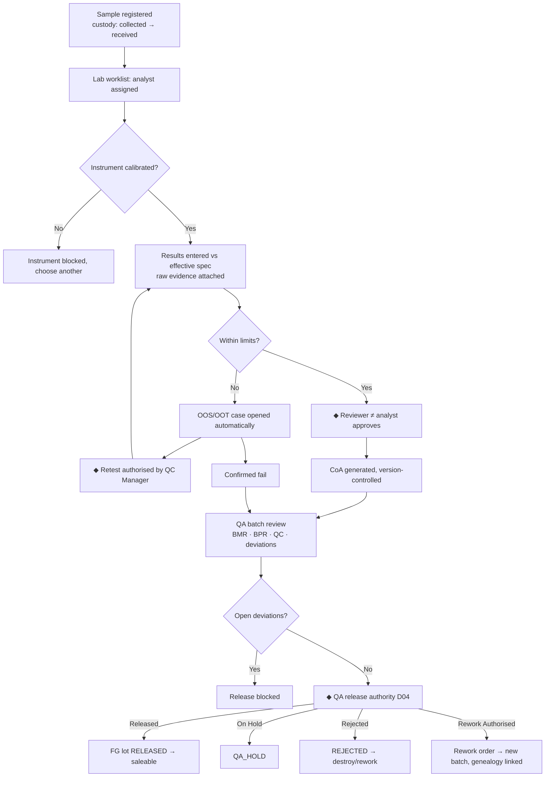

---

## 8. Dispatch & delivery

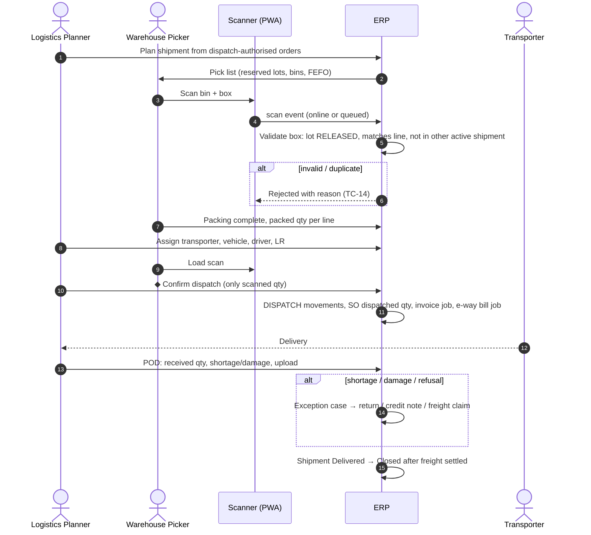

---

## 9. Returns & credits

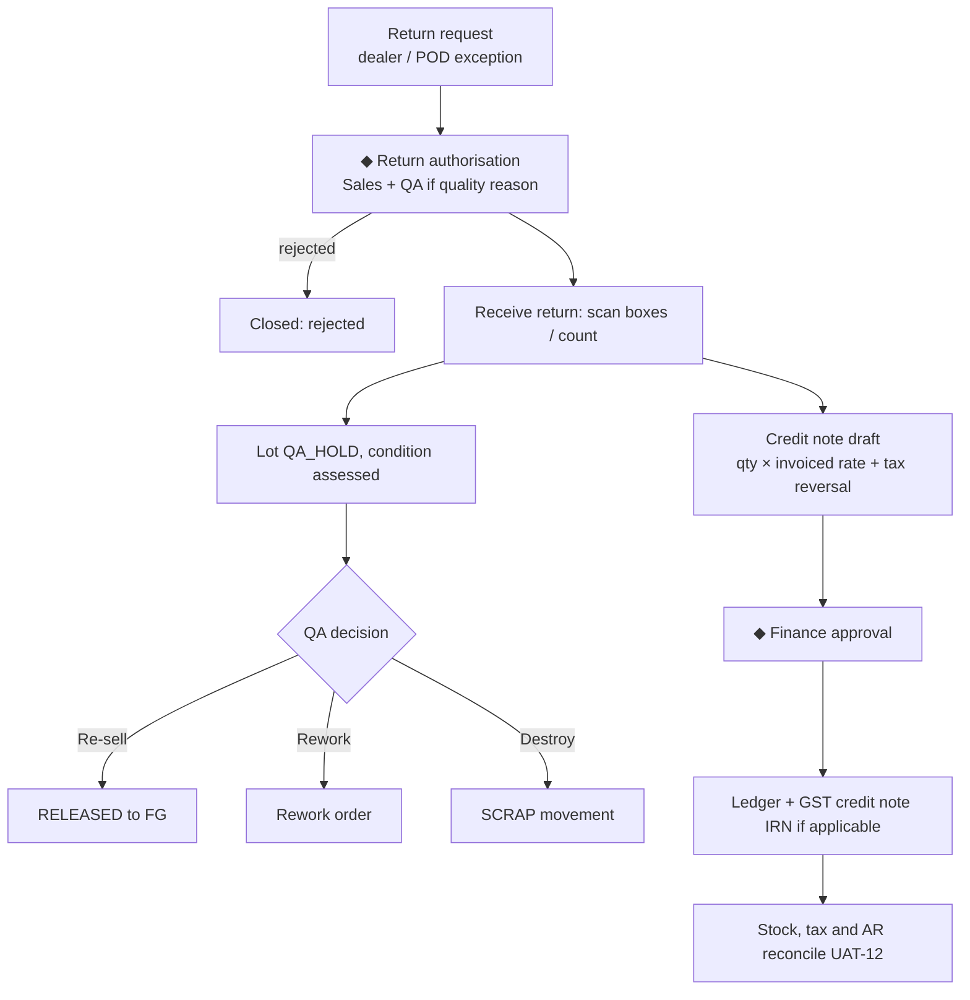

---

## 10. Product recall

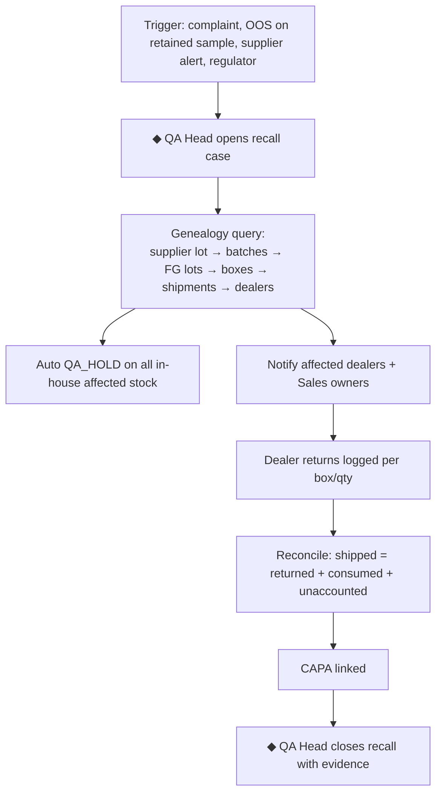

A drill mode runs the same scope query and a reconciliation report without changing stock status (MP§14.5).

---

## 11. Financial reconciliation

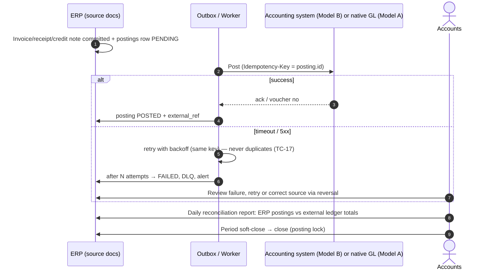

---

## 12. Document state machines (harmonised)

### 12.1 Sales order (harmonises MP§9.4 with P4 §4)

| State | Meaning | Next states |
|---|---|---|
| Draft | Editable by the creator | Submitted, Cancelled |
| Submitted | Validated; approval request created | Under Review |
| Under Review | Commercial or credit step pending. Sub-status shows `Commercial` or `Credit` | Approved, Rejected, On Hold, Draft (returned for correction) |
| On Hold | Held by an approver or by a system rule (credit, licence) | Under Review, Cancelled |
| Rejected | Final for this revision; a new revision can be created | — |
| Approved | All approvals done | Allocated, Backordered, Partially Fulfilled, Cancelled |
| Backordered | Not enough eligible stock | Allocated, Partially Fulfilled, Cancelled |
| Allocated (Ready for Dispatch) | Fully reserved and dispatch-authorised | Partially Fulfilled, Fulfilled |
| Partially Fulfilled | Some quantity dispatched | Fulfilled, Closed (short-closed with reason) |
| Fulfilled | All quantity dispatched | Closed |
| Cancelled | Before dispatch only; reservations released | — |
| Closed | Invoiced and settled, or short-closed | — |

An amendment to an `Approved`/`Allocated` order creates revision *n+1* in `Under Review` when the change is material (D17). Reservations are kept until the new revision is approved or rejected.

### 12.2 Other documents

| Document | Normal path | Exceptions |
|---|---|---|
| Quotation | Draft → Submitted → (Approval) → Approved/Sent → Accepted → Converted | Rejected, Expired, Superseded (by revision), Cancelled |
| Purchase requisition | Draft → Submitted → Approved → Partially Ordered → Ordered → Closed | Rejected, Cancelled |
| Purchase order | Draft → Submitted → Approved → Issued → Acknowledged → Partially Received → Received → Closed | On Hold, Rejected, Cancelled, Short-closed |
| GRN | Draft → Posted → (QC) → Accepted / Partially Accepted / Rejected | Reversed |
| Lot | Quarantine → Sampled → Under Test → Released | QA Hold, Rejected, Expired, Returned, Consumed |
| Production order | Planned → Approved → Released → In Progress → Completed → Closed | On Hold, Cancelled |
| Batch | In Progress → Completed → QC Pending → QA Review → Released → Closed | On Hold, Rework, Rejected |
| CAPA | Logged → Triaged → Investigation → Plan → Approved → Implementation → Effectiveness Check → Closed | Reopened, Escalated |
| Shipment | Planning → Picking → Packed → Loaded → Dispatched → In Transit → Delivered → Closed | Partial, Damaged, Returned (RTO), Disputed |
| Invoice | Draft → Issued → (IRN Generated) → Posted → Partially Paid → Paid | Cancelled (within the IRN window), Credit-noted |
| Dealer | Draft → Submitted → Verified → Commercially Approved → Credit Approved → Active | Returned, Rejected, Suspended, Inactive |
