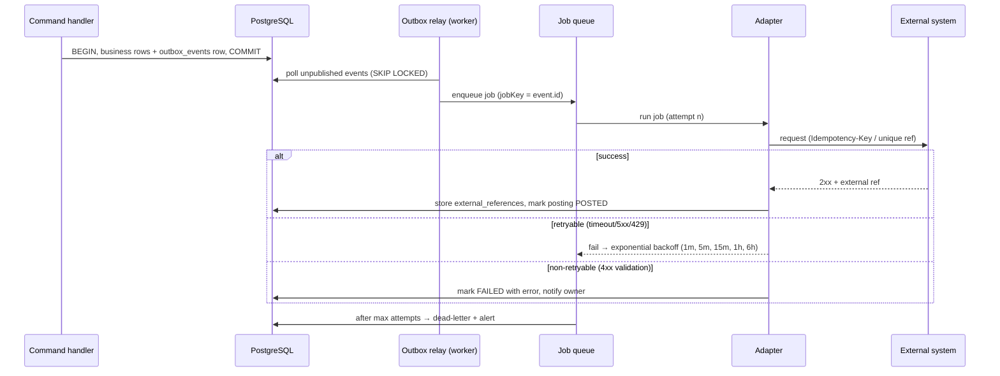

# 09 — Integration Plan

Covers MP §3.5, §17, §21 and §22, and P3 M14. Every integration goes through the **transactional outbox → worker → adapter** path. No external call happens inside a user request transaction.

## 1. Integration inventory

| # | Integration | Direction | Purpose | Provider (to be decided) | Decision | Release |
|---|---|---|---|---|---|---|
| I-01 | GST e-invoice (IRP) | Out / in | Generate IRN, Ack no and signed QR; cancel within the window | GST Suvidha Provider (GSP) or direct IRP API | D08, D27 | Core |
| I-02 | E-way bill | Out / in | Generate, update vehicle (Part-B), extend, cancel | Same GSP | D08, D27 | Core |
| I-03 | GSTIN verification | Out | Check taxpayer status and name during onboarding | GSP public search API | D27 | Pilot (manual fallback) |
| I-04 | Accounting system (Model B only) | Out / in | Post invoices, receipts, credit/debit notes, purchase invoices, payments; return voucher IDs | e.g. Tally Prime (XML/ODBC/TDL connector), Zoho Books, SAP B1. **Unknown; ask the client** | D02 | Core |
| I-05 | Email | Out | Notifications, quotation/PO/invoice PDFs | Amazon SES | D11 | Pilot |
| I-06 | WhatsApp Business | Out (+ delivery status webhook) | Approval alerts, dealer order and dispatch updates (approved templates only) | Meta Cloud API or a BSP | D11 | Core |
| I-07 | SMS (optional) | Out | OTP fallback, critical alerts | DLT-registered SMS provider | D11 | Optional |
| I-08 | Bank statement import | In | Bank reconciliation | CSV/MT940 file import first; bank API later | D02 | Core |
| I-09 | Label printers | Out | QR and box labels (ZPL/EPL) | Zebra/TSC through a print agent or browser print | D24 | Pilot |
| I-10 | Weighing scales | In | Capture dosing and packing weights | RS-232/USB through a local bridge, or manual entry | D09 | Enterprise |
| I-11 | Rugged scanners | In | Hardware scan wedge or SDK | Zebra/Honeywell (keyboard-wedge needs no SDK) | D09 | Core |
| I-12 | Maps / geolocation | In | Beat check-in GPS, distance validation | Browser Geolocation API; map tiles optional | — | Core |
| I-13 | Lead sources | In | IndiaMART lead pull | IndiaMART CRM API (pull) or CSV import | — | Core |
| I-14 | Identity federation (optional) | In | SSO | OIDC (Google Workspace / Microsoft Entra) | D22 | Optional |
| I-15 | Legacy data migration | In (one-time) | Masters, open documents, opening balances | Spreadsheet templates | D10 | Core |

## 2. Integration pattern

**Rules**

1. Each adapter is idempotent. Where the external API has no idempotency key, the adapter first queries by our document number (for example, IRN lookup by doc no and date) before it creates anything.
2. Every external interaction is written to `sys.integration_log` (request hash, response code, latency). Payloads are redacted for PII.
3. Credentials live in AWS Secrets Manager and are rotated per provider policy.
4. A failure **never rolls back** the business document. The document shows its `posting_status` / `irn_status` and the Accounts team works an exception queue (S-M12-10).
5. Inbound webhooks (WhatsApp status, GSP callbacks) are verified by signature and deduplicated on the provider event ID.

## 3. Specific design notes

### I-01/02 E-invoice and e-way bill
- Applicability (turnover threshold, exempt supplies), the IRN cancellation window and the e-way bill distance/validity rules must be **confirmed by the client's tax adviser** (D08). The system makes these values configurable and does not hardcode them.
- Invoice PDF printing waits for the IRN when e-invoicing applies. If the IRP is down, the invoice stays `Issued – IRN Pending`, and dispatch can proceed only under the policy the client approves.

### I-04 Accounting (Model B)
- Mapping tables: ERP party ↔ ledger name/code, item/HSN ↔ stock item (if inventory is mirrored) or a sales ledger by tax rate, and cost centres.
- Posting granularity: one voucher per source document (recommended for traceability).
- Daily reconciliation job compares ERP totals by voucher type and day with the external totals, and reports mismatches.

### I-06 WhatsApp
- Only pre-approved template messages. Opt-in is recorded per recipient. Approval notifications deep-link to the ERP; no approve-by-WhatsApp in phase 1 (security).

## 4. Integration testing

| Level | Approach |
|---|---|
| Contract | Adapter tests against recorded sandbox responses (GSP sandbox, Tally test company) |
| Failure | Fault injection: timeout after the request was accepted (expect no duplicate on retry, TC-17), 5xx bursts, malformed responses |
| End-to-end | Staging connected to provider sandboxes; UAT scripts cover invoice → IRN → e-way bill → accounting voucher |
| Monitoring | Alerts on DLQ depth > 0, posting failure rate > 1%, IRN pending > 30 min |
