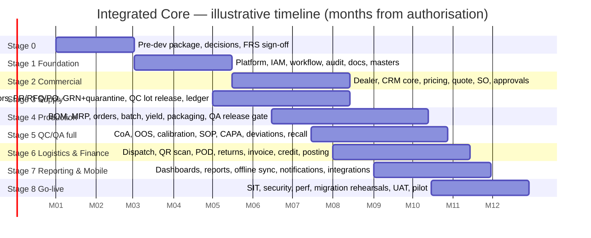

# 11 — Development Sequence, Roadmap & Estimated Work Packages

Covers MP Parts 26 and 30 Step 7, and P5. The months are illustrative for **Option B — Integrated Core** (P5 §1), which P5 recommends. Final schedule and cost follow D12, D13 and the signed SOW.

## 1. Sequencing principles

1. **Platform first.** Auth, RBAC and scope, the workflow/approval engine, audit, documents, numbering and the outbox must exist before any transactional module (MP Stage 1).
2. **No transactional module ships without its control gate.** MP Stage 5 puts QC/QA after Production, but MP Stage 5's own note says "essential quality and quarantine controls must be implemented alongside" the processes that depend on them. So:
   - GRN quarantine + QC sampling/results + lot disposition ship **with Stage 3** (Inventory).
   - The FG QA release gate + deviation blocking ship **with Stage 4** (Production).
   - The full QA suite (SOP, CAPA, audits, training, risk, recall) follows in Stage 5.
3. **Finance architecture (D02) is decided before Stage 2 ends.** Invoice and credit control touch orders.
4. **Vertical slices.** Each stage finishes with an end-to-end UAT for its slice, not just screens.

## 2. Stages and dependencies

| Stage | Depends on | Exit gate (P5 §2, P7 §9) |
|---|---|---|
| 0 Requirements & architecture | — | This package approved; P0 decisions closed; SOW signed; development authorised |
| 1 Foundation | 0 | Access and master tests passed; approval engine simulates the D01 policy correctly |
| 2 Commercial | 1, D01, D02, D07, D15, D16 | Order UAT: UAT-01…05, TC-02…06 |
| 3 Supply & inventory (+ QC lot release) | 1, D04, D05, D06 | PO/GRN/quarantine UAT: TC-07…10, UAT-06…07 |
| 4 Production (+ FG release gate) | 3, D03 | Stock and batch UAT: TC-11, TC-13, UAT-08…09 |
| 5 QC/QA full | 4 | Quality-to-delivery UAT: TC-12, UAT-15 (recall drill) |
| 6 Logistics & finance | 2, 4, D08, D09, D24, D27 | TC-14, TC-16, TC-17, UAT-10…14 |
| 7 Reporting, mobile, integrations | 6, D11, D23 | TC-15; KPI sign-off |
| 8 Testing & go-live | all | All TC-01…20 passed; reconciliation certificates; formal acceptance |

## 3. Minimum safe operational feature set (Pilot, Option A)

The smallest release that can run one plant's real transactions **without weakening any control**:

| Area | Included | Deferred |
|---|---|---|
| Platform | Auth + MFA, RBAC + scope, approval engine, audit, documents, number series | SSO, report builder |
| Masters | Legal entity, plant, warehouses/bins, employees/territory, dealers (with licences), vendors, items/packs, UOM, tax | Bulk import of the full history |
| Sales | Quotation, sales order, conditional approvals, credit check, allocation | Leads/CRM/beat/trials (manual for now) |
| Supply | PO (with PR), GRN → quarantine, QC result + lot disposition | RFQ/comparative statement, 3-way match automation |
| Inventory | Ledger, reservations, issue, transfer, adjustment with approval | Cycle count planner, valuation reports |
| Production | BOM versions, production order, batch execution, yield, packaging, box serials | MRP, OEE, costing |
| Quality | FG QA release gate, deviations (block release), CoA | CAPA suite, audits, training, risk |
| Logistics | Pick/pack/scan (online), dispatch, LR, POD | Offline scanning, freight reconciliation |
| Finance | Invoice from dispatch, receipts, dealer ledger, export to accounts | Native GL, bank reconciliation |

## 4. Estimated work packages

Effort is in **person-weeks (pw)** for the implementation partner. The ranges assume the decisions in doc 12 come out as recommended. Costs follow P5 §4 (illustrative ₹ lakh), with which these packages line up.

| WP | Scope | Main deliverables | Effort (pw) | P5 budget line |
|---|---|---|---|---|
| WP-00 | Discovery & FRS | BRD reconciliation (D00), full field dictionary, signed RTM, prototype sign-off | 16–22 | Discovery 8 |
| WP-01 | Platform core | Monorepo, CI/CD, environments, IAM/MFA, RBAC + scope, audit, settings, number series | 14–18 | Foundation 14 |
| WP-02 | Workflow & approval engine | State machines, policy designer and simulator, inbox, delegation, SLA | 10–14 | Foundation |
| WP-03 | Documents, notifications, outbox, jobs, PDF | Vault, AV scan, templates, email | 8–10 | Foundation |
| WP-04 | Master data | 20 masters, lifecycle, duplicates, import | 12–16 | Foundation |
| WP-05 | Dealer onboarding & 360 | Wizard, stages, licences, expiry jobs | 8–10 | Sales 14 |
| WP-06 | CRM (18 submodules) | Leads → opportunities, activities, targets, samples, trials, beat, competitors, recovery | 18–24 | Sales |
| WP-07 | Pricing, quotation, sales order, allocation | Calculation engine, versions, amendments, credit check, reservations | 16–20 | Sales |
| WP-08 | Procurement | PR, RFQ, comparative statement, PO, 3-way match, returns | 14–18 | Proc & Inv 20 |
| WP-09 | Inventory & warehouse | GRN, lots, ledger, reservations, transfers, counts, adjustments, valuation | 16–20 | Proc & Inv |
| WP-10 | QC laboratory | Specs, samples, results, review, CoA, OOS, calibration, lot disposition | 14–18 | QC/QA 16 |
| WP-11 | Manufacturing | BOM, MRP, production orders, batch console, dosing, yield, packaging, OEE, cost, trace | 24–30 | Mfg 20 |
| WP-12 | QA suite | 17 submodules, FG release, recall | 18–24 | QC/QA |
| WP-13 | Logistics & serialisation | Dispatch board, pick/pack, scan, LR, POD, returns, freight, QR, public verify | 14–18 | Logistics 9 |
| WP-14 | Mobile PWA & offline sync | Scanner, offline queue, conflict resolution, device registry, field-sales screens | 10–14 | Logistics / Mfg |
| WP-15 | Finance (Model B baseline) | Invoice, e-invoice/e-way bill, credit control, receipts, notes, payables, postings, period lock | 14–20 (Model A: +20–30) | Finance 9 |
| WP-16 | Integrations | GSP, accounting adapter, WhatsApp, IndiaMART | 8–12 | Finance |
| WP-17 | MIS & reports | 10 dashboards, 55 reports, KPI dictionary, exports | 12–16 | spread |
| WP-18 | UX/design system | Tokens, component library, page templates, accessibility | 10–12 | spread |
| WP-19 | QA engineering | Automated regression, performance, security testing support | 20–28 | spread |
| WP-20 | Migration, UAT, training, go-live | Templates, loads, rehearsals, training material, hypercare | 14–20 | Migration 12 |
| | **Total** | | **≈ 310–404 pw** | **₹122 L base + 15% = ₹140.3 L (P5, illustrative)** |

At about 8–9 delivery FTE (P5 §3), 310–404 pw comes to roughly **9–12 months** of build after Stage 0, in line with P5's 9–15 months for Option B. Native accounting (Model A), full multi-plant rollout or IoT/scale integration need separate costing (P5 §4).

## 5. Delivery risks to the sequence

| Risk | Effect | Mitigation |
|---|---|---|
| BRD v2.4 not supplied (D00) | RTM may miss line items | Make WP-00 the first task; freeze the RTM before Stage 1 exit |
| D01/D02 undecided by Stage 2 | Rework of approval and invoice flows | Escalate as P0 decisions with a date |
| D13 says "adapt an existing ERP" | This plan is replaced by a fit-gap plan | Run the build-vs-adapt assessment in Stage 0 |
| Scanner hardware not tested (D09) | Offline design changes | Device pilot in Stage 3 |
| Regulatory rules unverified (D08) | Licence and tax logic changes | Configurable rules plus an adviser sign-off before Stage 6 |
